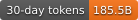

開発したアプリの一部は、オープンソースライセンスで[株式会社アグロデザイン・スタジオのリポジトリ](https://github.com/AgroDesign-Studios)より配布しています。  
Some of the apps I have developed are distributed under open-source licenses from the [AgroDesign Studios repositories](https://github.com/AgroDesign-Studios).

<!-- viberank badges hidden 2026-11-15 (owner: 一旦外す). To restore, move this block back out of the comment.
### viberank

AI コーディング使用量の公開ランキング viberank での順位。Claude Code と Codex の合算。  
Rankings on viberank, a public leaderboard of AI coding usage. Claude Code and Codex combined.

  
累積の総合順位（API金額換算値）と総トークン数。  
Cumulative overall rank (by API-equivalent cost) and total tokens.

  
直近 30 日のトークン数順位とトークン数  
Token rank and token count over the last 30 days
-->

<!--

**YukiNishigaya/YukiNishigaya** is a ✨ _special_ ✨ repository because its `README.md` (this file) appears on your GitHub profile.
Here are some ideas to get you started:

- 🔭 I’m currently working on ...
- 🌱 I’m currently learning ...
- 👯 I’m looking to collaborate on ...
- 🤔 I’m looking for help with ...
- 💬 Ask me about ...
- 📫 How to reach me: ...
- 😄 Pronouns: ...
- ⚡ Fun fact: ...
-->
